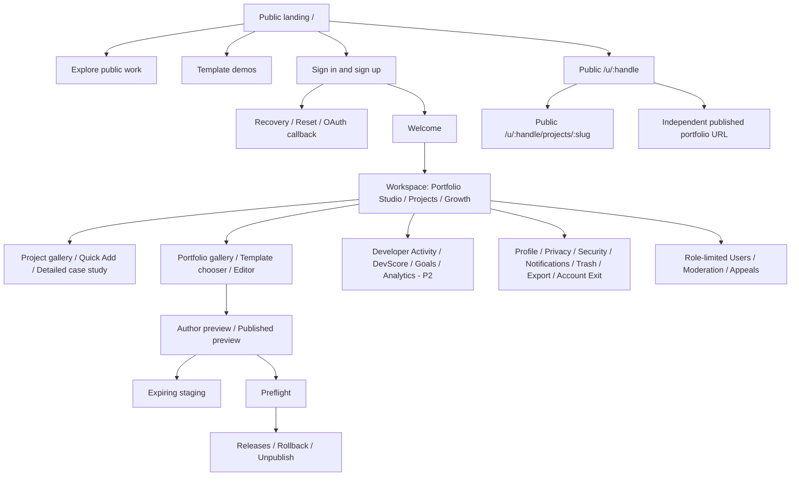

# Information Architecture and Navigation

> **Kadmeion planning artifact · 12 November 2026 · NOT IMPLEMENTED.** `[APPROVED]` = explicit owner choice; `[PROPOSED]` = specification or architecture suggestion; `[PROOF]` = requires technical/test evidence. No code, deployment, integration, screenshots or performance claims are implied.

## Site map

## Navigation rules

1. Distinguish public landing navigation, compact auth shell, workspace side rail, full editor and restricted admin context. Maintain breadcrumbs and clear Back/cancel context.
2. Auth sign-in/signup mode switching does not add history entries. Page deep links (reset callback, public route) remain reloadable.
3. Editor section panels are **views** of one saved revision, not different project documents. Source and canvas paths must be synchronized through one writer.
4. Public identity and case studies occupy reserved `/u/` namespace; published portfolio routes must not shadow `/app`, `/signin`, `/signup`, `/auth`, `/r`, `/templates` or `/u`.
5. A developer may publish a portfolio independently of the public identity hub; do not implicitly open either when the other becomes public.
6. Mobile workbench operations are blocked; mobile public/appropriate account/goal screens remain usable.

## Content taxonomy

Identity → owned projects → optional public case studies → owned portfolios → versioned private drafts → staged read-only preview → releases → owner-controlled public projections → optional growth facts/goal/analytics (private until explicit owner action). No public developer leaderboard.
