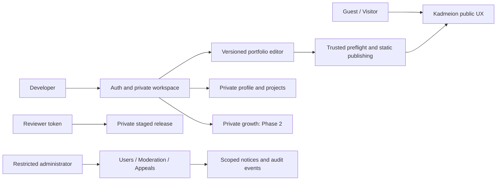

# Use Cases and Actor Interactions

> **Kadmeion planning artifact · 12 November 2026 · NOT IMPLEMENTED.** `[APPROVED]` = explicit owner choice; `[PROPOSED]` = specification or architecture suggestion; `[PROOF]` = requires technical/test evidence. No code, deployment, integration, screenshots or performance claims are implied.

## Use cases in UML-style descriptions

| Use Case | Primary actor | Trigger | Include / extend | Postcondition |
|---|---|---|---|---|
| UC-01 Register/sign in | Guest | Enter credentials | handle validation; optional Google; recover | Owner session established |
| UC-02 Publish identity | Developer | Publish Profile | safe-field preview, privacy confirmation, route verify | Explicit public identity hub |
| UC-03 Create/edit project | Developer | Add Project | link validation; optional thumbnail; case study | Private project draft |
| UC-04 Create portfolio | Developer | Choose Template/Blank | authenticate, capability gate | Versioned private portfolio |
| UC-05 Modify slot | Developer | Add/Swap/Delete | typed operation, stash, Undo, guarded source | Committed revision |
| UC-06 Edit custom source | Developer | Customize/Advanced | owned file, diagnostics, last-good | Owned code, untrusted by default |
| UC-07 Preview/publish | Developer | Stage/Publish | preflight, privacy choice, host verification | Verified immutable release |
| UC-08 Revoke/restore | Developer | Unpublish/Trash | authoritative delivery revoke, retention | Route disabled; data recoverable if eligible |
| UC-09 Inspect growth | Developer | Open growth | optional permitted source sync/score/goal | Private progress views |
| UC-10 View public work | Visitor | Open public URL | owner-selected public fields and project links | No private data |
| UC-11 Review staging | Reviewer | Open expiry token | token validation, revocation check | Read-only pinned preview |
| UC-12 Manage account | Developer | Settings/Security/Delete | sessions, privacy, export, erasure confirmation | Account settings or termination |
| UC-13 Manage abuse | Operator | Case/restriction | authorization, notice, audit, appeals | Scoped case resolution |

## Detailed UC-07 publication preconditions

Authenticated owner, supported editor, frozen valid revision, no unpublishable source, publish-preflight checks passed, verified host, explicit visibility choice and quota headroom. **Exception flows:** invalid slot, unauthorized asset, custom JS exposure, host failure, stale pointer, unlisted/private access, expired staging or public-route verification failure. No reported success until final visitor fetch confirms expected revision.

## Project truthfulness use case

A developer may provide *any* valid manually authored project even without GitHub. If a repository URL is attached, the card opens it; it does not claim ownership or read/import repository contents. If no working live capture exists, user-uploaded screenshot or fallback cover is still a valid project entry.

## System boundary diagram

