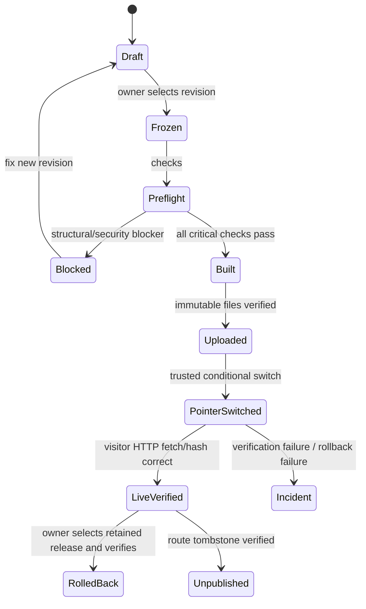

# Logical API/Command Catalog and Event Contracts

> **Kadmeion planning artifact · 12 November 2026 · NOT IMPLEMENTED.** `[APPROVED]` = explicit owner choice; `[PROPOSED]` = specification or architecture suggestion; `[PROOF]` = requires technical/test evidence. No code, deployment, integration, screenshots or performance claims are implied.

**These names are conceptual interfaces, not deployed HTTP endpoints.** Transport may be Supabase Auth client methods, RLS-backed SQL/PostgREST, RPC and trusted Edge HTTP actions. Do not create a parallel Express backend.

| ID | Logical command | Actor | Idempotency and authorization notes |
|---|---|---|---|
| AUTH-01 | `auth.signUpEmailWithHandle` | Guest | Normalize handle; authoritative uniqueness; rate/quotas; no public confirmation implied |
| AUTH-02 | `auth.signInPassword` / `auth.signInGoogle` | Guest | Safe OAuth state/callback, no account enumeration |
| AUTH-03 | `auth.requestPasswordReset` / `auth.updatePassword` | Guest/token | SMTP proof, reset expiry, no secret in logs |
| AUTH-04 | `auth.getSessions/revokeOtherSessions` | Owner | Only expose sessions that provider actually supports |
| PROFILE-01 | `profile.getMine/updateMine` | Owner | RLS; private fields never projected publicly |
| PROFILE-02 | `profile.previewPublic/publish/revoke` | Owner | Explicit selected fields, verified public URL |
| PROJECT-01 | `project.create/updatePrivate` | Owner | Private default, quick-add before thumbnail service |
| PROJECT-02 | `project.setPublicSurfaces` | Owner | Confirm profile/portfolio/case-study projections; host revocation proof |
| MEDIA-01 | `media.upload/replace/tryCapture` | Owner | Safe MIME, quotas, SSRF control, private default; capture conditional |
| EDITOR-01 | `revision.commitTypedIntent` | Owner | opId, baseRevision CAS, atomically guarded; no raw custom patch |
| EDITOR-02 | `project.localSave/export/recover` | Local owner | Browser/folder journaling and external-hash comparison |
| STAGE-01 | `preview.stage/createLink/revokeLink` | Owner | Hash token, pinned revision, expiry and revocation |
| PUBLISH-01 | `release.preflight` | Owner | Blockers/Warnings/Passed, pinned manifest and trusted build |
| PUBLISH-02 | `release.requestPublish` | Owner | Idempotency key, expected pointer, explicit visibility |
| PUBLISH-03 | `release.verify/rollback/unpublish` | Owner/trusted | Public HTTP status/hash verification; conditional pointer logic |
| PUBLISH-04 | `release.renameCanonicalUrl` | Owner | Reserved routes, redirects only if tested |
| GROWTH-01 | `provider.lookupPublic/sync/disconnect` | Owner, P2 | Source permission, rate limit, remove imported facts by default |
| GROWTH-02 | `devscore.getPrivate/goals.update` | Owner, P2 | Source provenance; suppress weak composite |
| ANALYTICS-01 | `analytics.setPortfolioOptIn/getAggregates` | Owner, P2 | Off by default, no personal visitor identifiers |
| ACCOUNT-01 | `trash.move/restore/purgeItem` | Owner/trusted | Route revoked first, 15-day recoverable item |
| ACCOUNT-02 | `account.requestErasure` | Reauthenticated owner | Guided export, separate erasure with documented retention |
| ADMIN-01 | `admin.users.restrict/restore` | Narrow operator | Justification/notice/audit, no impersonation |
| ADMIN-02 | `admin.portfolio.temporaryUnpublish` | Narrow operator | Qualified abuse, scope and appeals, verify route |
| ADMIN-03 | `admin.appeal.decide` | Narrow operator | Case history, minimized evidence, restoration checks |

## Request shape: typed operation (illustrative)

```json
{
  "opId": "synthetic-operation-id",
  "portfolioId": "synthetic-portfolio-id",
  "baseRevision": "revision-0008",
  "intent": "SWAP_COMPONENT",
  "target": {"sectionId": "hero-01", "slotId": "title"},
  "payload": {"nextComponent": "title-stacked@1"}
}
```

On accepted commit return new revision ID, touched file hashes, stashed content identifier, actual save location and confirmation proof. On rejected base return conflict, latest revision and available actions, **never auto-apply stale change**.

## Response and error model

```json
{
  "code": "REVISION_CONFLICT",
  "message": "This portfolio changed in another tab.",
  "retryable": false,
  "target": {"portfolioId": "synthetic-portfolio-id"},
  "safeActions": ["Compare", "Keep both", "Cancel"]
}
```

Use stable categories: VALIDATION, FORBIDDEN, AUTH_EXPIRED, RATE_LIMITED, QUOTA_EXCEEDED, INVALID_SOURCE, UNSAFE_CUSTOM_SCRIPT, REVISION_CONFLICT, STAGING_EXPIRED, CAPTURE_UNAVAILABLE, RELEASE_VERIFY_FAILED, PUBLIC_REVOKE_UNVERIFIED, PROVIDER_UNAVAILABLE. Old editor blueprint error IDs E01–E36 are source provenance and should not be silently renumbered.

## Publication state machine



Only `LiveVerified` can render “Published successfully.” Do not log passwords, OAuth codes, raw reviewer tokens or private source. An admin audit event includes actor, reason, affected public route, timestamps, action and verification evidence; no privileged editorial access.
