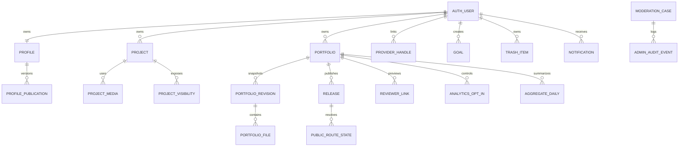

# Proposed PostgreSQL Data Model, RLS and Storage Policy

> **Kadmeion planning artifact · 12 November 2026 · NOT IMPLEMENTED.** `[APPROVED]` = explicit owner choice; `[PROPOSED]` = specification or architecture suggestion; `[PROOF]` = requires technical/test evidence. No code, deployment, integration, screenshots or performance claims are implied.

**No migration, policy or storage bucket has been executed.** This is a logical model requiring real Supabase schema review, index sizing, FK and row-level policy tests.

## Logical entities and relationships

| Entity | Minimum responsibility | Owner/private rule |
|---|---|---|
| Auth user | Canonical identity in Supabase Auth | Auth controlled |
| `profiles` | Unique normalized handle, display name, bio, avatar, selected public fields, verified badge source | Owner fields private; public projection only when Publish Profile |
| `profile_publication` | Explicit live visible fields and current public identity state | Trusted release control |
| `projects` | Owner, title, description, role/year/type, stack, repository/demo URLs, case sections, visibility | Private by default; per-surface publication table |
| `project_visibility` | Public hub/portfolio/case-study exposure with revision and tombstone | Owner and trusted resolver |
| `project_media`/`assets` | Uploads, image metadata, alt, source hash, safe transform, usage refs | Private source; copied safe assets to releases |
| `portfolios` | Owner, title, slug, template/pins, draft head, author tokens | Owner private; published projection separate |
| `portfolio_revisions`/`files` | Immutable linear revisions, file references, checksum and owner-aware source provenance | Only owner; no raw public source |
| `stashes`/`unplaced` | Slot-deleted/ unmatched content and custom code references | Owner only, retention guarded |
| `reviewer_links` | Token hash, pinned revision, expiry, revocation and scope | No raw token read after issuance |
| `release_requests` | Idempotency key, frozen revision, check/run status and errors | Owner/privileged publisher |
| `releases` | Immutable release manifest/hash, metadata, asset refs, revision mapping | Public content only through trusted resolver |
| `public_route_states` | Current visibility pointer, 404/410 tombstone and redirect/routing metadata | Trusted host/resolver; exact authority TBD |
| `provider_handles`/`provider_facts` | Optional public-handle link, permitted source data, timestamp/provenance, sharing switches | Owner private; delete imported facts by default on disconnect |
| `devscore_results`/`goals` | Private explainable score/category data and manual/sourced milestone progress | Owner only; phase 2 |
| `analytics_opt_in`/`aggregate_daily` | Per-published-portfolio opt-in and privacy-safe aggregated counts | Default disabled; owner sees only own aggregates |
| `notifications` | Actionable security/publish/account events, read state and preferences | Owner only |
| `trash_items` | Recoverable item, deleted_at, purge deadline + authoritative route revoke evidence | Owner; 15 days |
| `account_erasure_jobs` | Separate account deletion policy/status and disclosed backup lifecycle | Privileged narrow authority |
| `moderation_cases`/`admin_audit_events` | Abuse reason, scoped public route, operator decision, notice, appeal | Role-scoped with minimal PII, audit trail |
| `usage_ledger` | Enforced owner/storage/signup/publish/free-service quotas | Trusted counters and fail-closed caps |

## Logical entity relationship diagram

## Row and object authorization matrix

| Data | Anonymous | Owner | Other signed-in account | Restricted admin |
|---|---|---|---|---|
| Unpublished profile/details | Denied | Own only | Denied | Not routine access |
| Published profile projection | Yes, selected public fields | Yes | Yes | Yes |
| Private projects, revisions, owned component source and assets | Denied | Own only | Denied | Denied unless exceptional separate legal authority, not feature default |
| Public project case study and portfolio | Only with active public/unlisted route policy | Yes | Same public rules | Same public rules, plus narrow temporary takedown |
| Private DevScore/goals/aggregate analytics | Denied | Own only | Denied | Denied by default |
| Reviewer pinned preview | Valid server-verified token only | Own | Valid token only | Not automatic raw access |
| User access restrictions / abuse cases | Denied | Appeal/request own status | Denied | Restricted authorized operation with audit |

## Important RLS design tests

Enable RLS for every exposed table and audit *both* SQL grants and policies. Owner checks use actual JWT subject (not UI userId). Test anonymous, owner A, owner B, role-limited operator, expired JWT, Storage signed URL, nested joins and public projections. Avoid stale JWT admin privilege assumptions; sensitive privileges revalidate at authoritative server. Never put Supabase service secret in browser or static export.

### Specific security edge cases

- A normal logged-in user must not read another user's unpublished `portfolio_revisions` by foreign ID or by joining through a release ID.
- Signed raw-asset URLs and deleted project images cannot stay externally usable after privacy revocation beyond documented bound; direct asset path policy must be tested.
- Reviewer token validity/revocation must be checked at the actual delivery boundary; hiding from the app UI is not sufficient.
- Public profile badges use positive Auth-provider email verification only, not account-handle match or GitHub ownership.
- If a project is made private but remains embedded in an immutable public portfolio release, fail closed: suspend affected public route(s) until a safe republished projection has been verified. **This is a proposed privacy-preserving engineering fallback, not proof of instant revocation.**

## Storage classes and retention

Owner files and media in private buckets, staged output access-controlled; immutable public static release objects stored separately when safe host selected. Media should be sanitized/normalized (including SVG restrictions, metadata stripping where appropriate), size/path/rights-checked and reference-counted across retained revisions. Item Trash is 15 days; account erasure differs. Backup retention and third-party archives disclosed rather than falsely promised instant removal.
