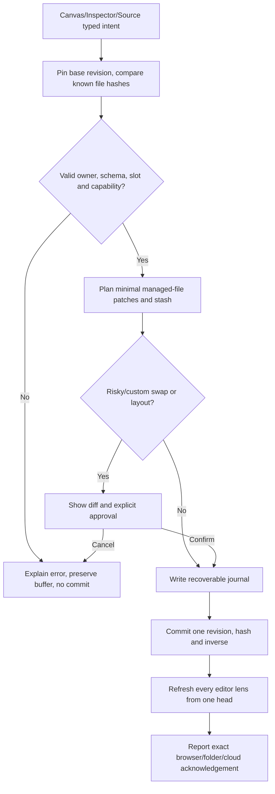

# Editor Engine, Project Files, Slots, Transactions and History

> **Kadmeion planning artifact · 12 November 2026 · NOT IMPLEMENTED.** `[APPROVED]` = explicit owner choice; `[PROPOSED]` = specification or architecture suggestion; `[PROOF]` = requires technical/test evidence. No code, deployment, integration, screenshots or performance claims are implied.

## 1. The durable project file set is the source of truth

```text
portfolio/
  kadmeion.json                    # managed project manifest: formatVersion, project ID, pins
  kadmeion.lock.json               # exact dependency and component manifest hashes
  pages/home.page.json[ c ]       # managed sections, layout IDs and typed assignments
  content/home.content.json[ c ]   # text, link and media references, aliases
  theme/tokens.json[ c ]          # tiered semantic and responsive overrides
  slots/<section-id>.<slot-id>/    # explicitly user-owned TSX/CSS or JS, opaque to visual rewriting
  components/<custom-id>/          # versioned My Components implementation and manifest
  assets/<sha256>.<ext>            # user-owned media plus metadata
  .kadmeion/                       # journals, stash, revision history (private; not published)
```

The `json[ c ]` convention above means **conditional JSONC vs JSON**, not an actual file extension. JSONC is accepted only after lossless patch benchmarks. Project ZIP includes owned sources and references, never session tokens, service keys, admin data or unrelated private imported provider facts. Public static ZIP only contains selected release output.

## 2. Canonical model

`Portfolio → ordered sections → pinned layout → stable named slot → assignment (EMPTY | component@version | owned component) → typed props + content + scoped CSS tokens + responsive overrides`.

| Assignment state | What it means | Safe next actions |
|---|---|---|
| EMPTY | No implementation assigned. Content and source previously removed stored in stash/history. | Add, restore, Undo. Publish blocks if required. |
| S0 | Trusted library component code pristine/read-only. | Change content/tokens/variants, swap, Customize. |
| S1 | User-owned override, byte-identical to original pinned library code. | Edit own file; protected change/cancel. |
| S2 | User-owned override differs from original. | Keep as My Component / Replace and Stash / Cancel; disclose file diff. |

Orthogonal statuses include grammar-invalid, source compile-error, stale-preview, storage conflict and unpublished-changes; these are **not** alternative slot states.

## 3. Transaction pipeline



**Preconditions:** stable owner and base revision, guarded grammar, permission and quotas, manifest compatibility, typed fields. Managed structure is patched only in known fields; all opaque owned code remains byte-for-byte unless the user explicitly edits it in the source editor. No optimistic success before actual storage adapter acknowledgement.

## 4. Slot replacement and content mapping

- Delete assigned block → EMPTY typed assignment; preserve outgoing content and override, media references and touched file history; return a visible Add/Undo target; do not generate a phantom empty user-code module.
- Add to EMPTY → compatibility filter, stable component version, declared fields and alias mapping; unmatched content to **Unplaced** tray, no data loss or truncation.
- Swap S0 → show compatibility/mapping; one undoable revision. Swap S1/S2 → impact dialog and explicit Keep/Replace-and-Stash/Cancel.
- Change layout → side-by-side previews, slot-to-slot mapping, unmatched stash before confirmation, keyboard and drag ordering equivalents.
- Replace media → update asset ID, alt and focal metadata, preserving historic referenced assets until revision and backup retention allow removal.

## 5. Custom code and theme token contract

`Customize` detaches a vetted library usage into a user-owned file. The original library stays read-only. The source editor may edit opaque user files; the visual composition editor does **not** parse arbitrary JS/TSX back into editable slots. Custom code can voluntarily consume `--k-*` tokens and typed props. Scoped theme overrides are emitted as clean CSS custom properties; no automatic rewrite of arbitrary source. Code may compile only in validated restricted preview contexts and cannot publish active user JavaScript until independent hostile-origin proof passes.

## 6. Autosave, conflicts, history, offline

- Local unsaved buffer and committed revision are distinct. Saving to browser, optional directory and Supabase cloud are separate statuses.
- IndexedDB transaction atomicity applies only to the stores included in the actual database transaction. Folder writes need journaling and crash recovery, not a false multi-file atomicity guarantee.
- Stale base revisions from second tabs/devices cause Compare / Keep Both / Restore / Retry. No last-write-wins.
- Linear immutable snapshots with named checkpoints, diff and restore. **Restore commits a new head** while preserving historical revisions; no branching implied.
- Invalid source is retained as buffer; previous successful preview displays STALE, not a representation of current edits.
- Use portable export and tested storage warnings because browser data may be evicted; public host persistence is separate from local portability.

## 7. Contract acceptance examples

| Test | Expected invariant |
|---|---|
| Delete filled required slot | Draft saved, slot EMPTY, original content accessible, publication blocked. |
| Swap S2 into incompatible component | No destructive change; impact/cancel; no owned source overwritten. |
| External managed file JSONC has broken syntax | Preserve exact bytes, last-good stale, read-only repair route. |
| Two tabs commit against same base | One accepted head; second rejects and preserves alternate draft. |
| Theme component-scoped typography override | CSS variable applied to intended component and static export, not arbitrary source rewrite. |
| Export project and reimport offline | All owned source, manifest pins, assets and compatible edits preserved, no credentials. |
