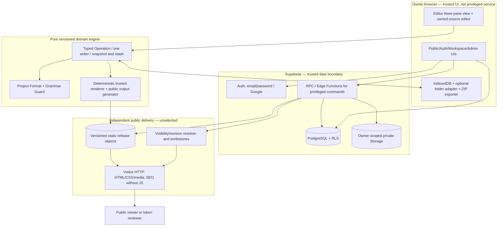

# High-Level Architecture and Trust Boundaries

> **Kadmeion planning artifact · 12 November 2026 · NOT IMPLEMENTED.** `[APPROVED]` = explicit owner choice; `[PROPOSED]` = specification or architecture suggestion; `[PROOF]` = requires technical/test evidence. No code, deployment, integration, screenshots or performance claims are implied.

## Architecture decision

**Approved:** Greenfield Kadmeion browser application; Supabase Auth, PostgreSQL with RLS, private Storage, trusted Edge Functions/Postgres RPC. No persistent Express/MongoDB backend. Open-source-compatible application dependencies and strict ₹0 recurring expense. Static portfolio delivery host is unselected until rigorous tests prove JS-off HTML, durable immutable assets, route revocation, privacy and cost.

## Component diagram

## Trust model and data responsibility

| Component | Trusted to do | Explicitly **not** trusted to do |
|---|---|---|
| Public/auth React UI | Collect inputs, show source-of-truth responses | Enforce ownership alone, hold service keys, execute uploaded JS |
| Pure editor core | Validate typed patches, preserve owned files, compute deterministic revisions | Query browser DOM/network as domain authority, silently publish |
| Preview/compiler | Produce diagnostic/last-good and static output under restricted runtime | Access Supabase sessions, application origin, cross-site cookies or privileged APIs |
| Supabase Auth/RLS | Authoritative identity and per-row ownership | Guarantee public pages remain available during database pause |
| Edge/RPC | Privileged publish, quota, admin/abuse, purge, idempotency | Silently trust client-supplied owner IDs or file hashes |
| Public host | Serve rendered releases and controlled route states | Offer unproven instantaneous global cache invalidation by declaration |
| Admin operator | Restricted user/release actions with audit | Impersonate authors, view private source indiscriminately, rewrite portfolios |

## Five contracts (from approved editor blueprint)

1. **Project Format:** portable file manifest, schema version, pins, owner-neutral paths, contents, theme and opaque owned code.
2. **Component Protocol:** stable `id@version`, accepted slot types, field schemas/aliases, dependencies, variants, a11y and capabilities.
3. **Operation Contract:** idempotent typed intent, base revision, preconditions, file-hash touched set, crash journal and undo metadata.
4. **Build Contract:** pinned compiler/source assets, static output, metadata and integrity hashes; same release restrictions in Published Preview and export.
5. **Release Contract:** frozen revision, preflight gates, immutable release bytes, conditional public pointer change, verify, rollback and private/public access.

## Decisions still implementation-dependent

- Source rendering engine/Puck vs bounded custom slot canvas (compatibility, a11y and one-writer proof).
- JSONC lossless comment-preserving patches versus guarded managed JSON.
- Exact public delivery host, independent pointer/visibility authority, cache budgets and domain availability.
- Isolation of compiled user-owned source and degree of permitted static-only output.
- Free SMTP sender availability and provider terms for open sign-up and recovery.

These are technical verification gates, not reasons to invent a second application backend.
