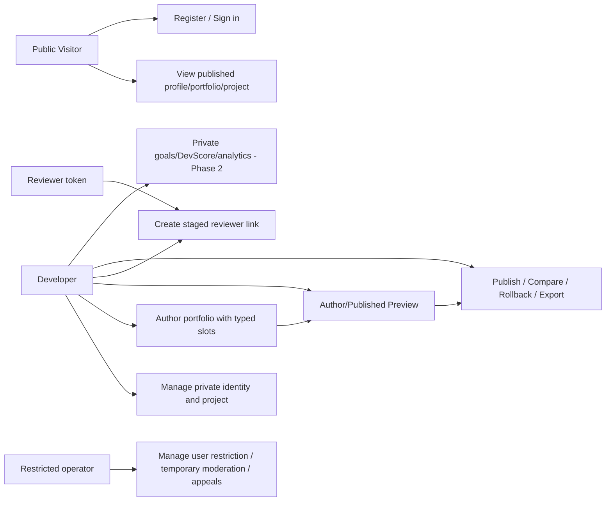
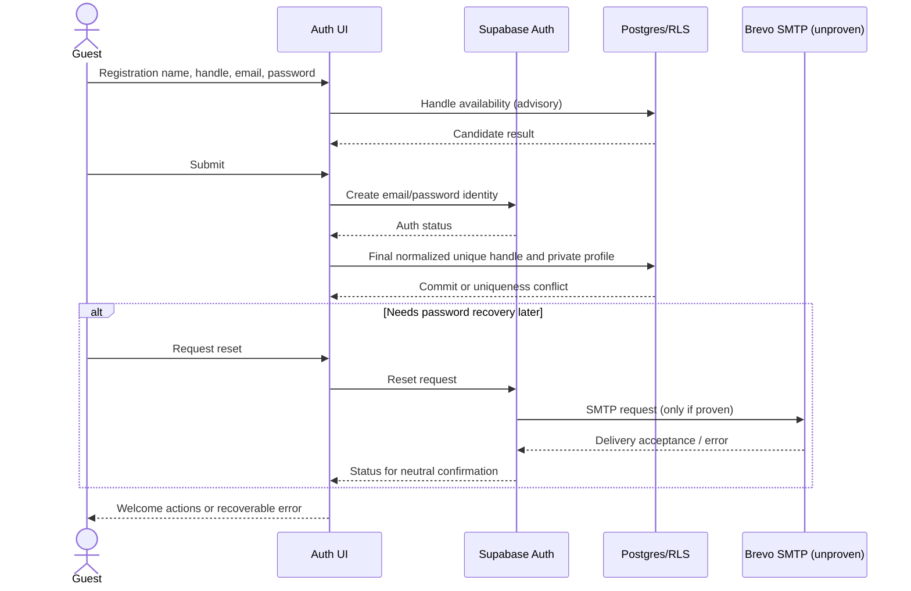
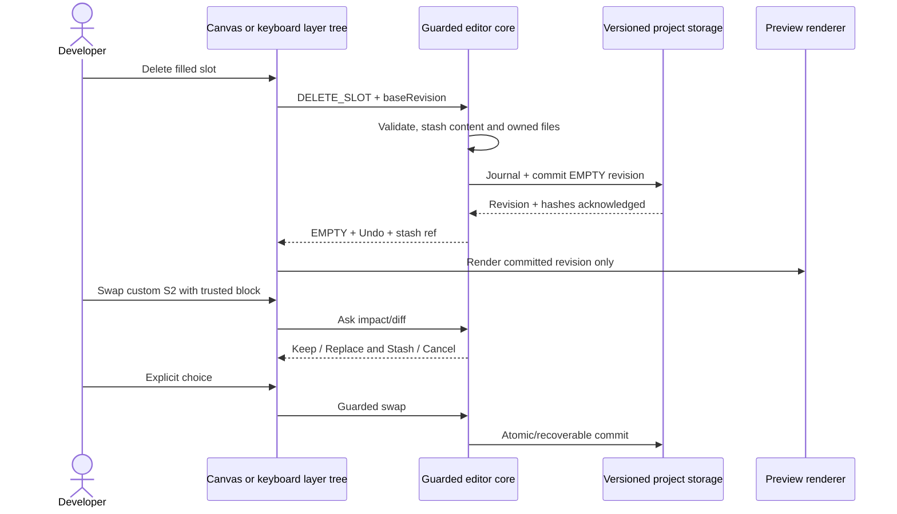
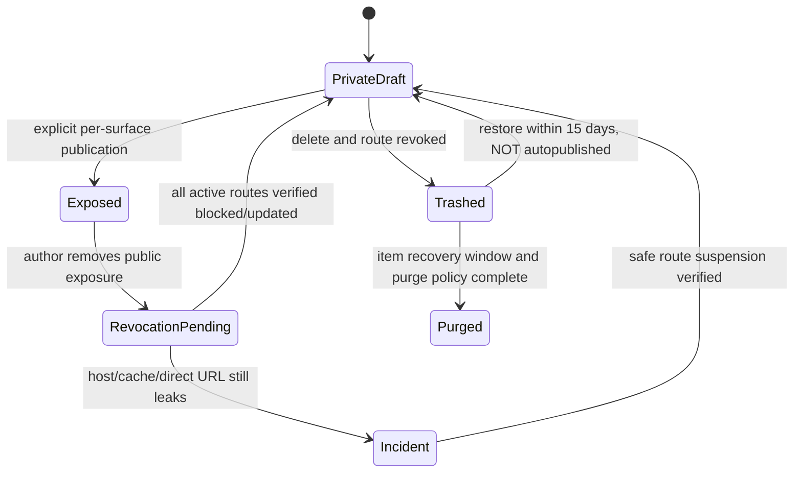
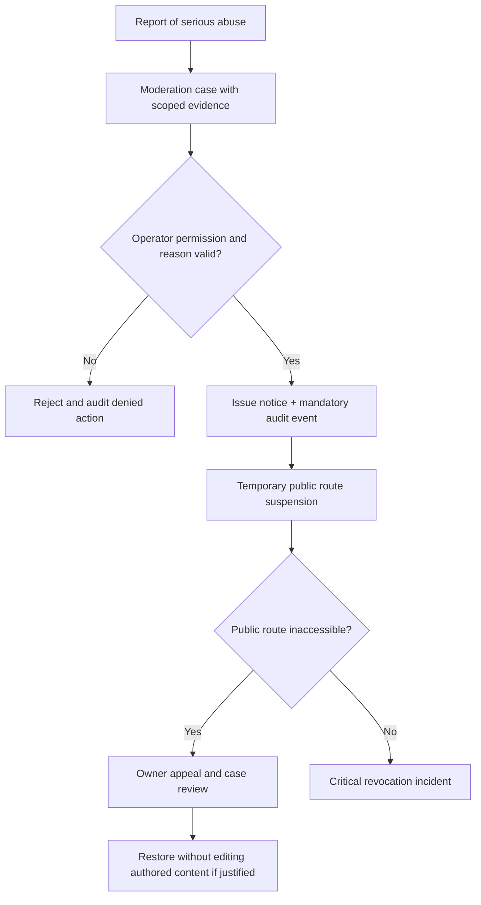

# Architecture, Use Case, Activity, Sequence and State Diagrams

> **Kadmeion planning artifact · 12 November 2026 · NOT IMPLEMENTED.** `[APPROVED]` = explicit owner choice; `[PROPOSED]` = specification or architecture suggestion; `[PROOF]` = requires technical/test evidence. No code, deployment, integration, screenshots or performance claims are implied.

These Mermaid diagrams are **design models**, not diagrams reverse-engineered from a completed application. Rendering requires Mermaid-compatible Markdown viewer.

## 1. Overall use case relationships



## 2. Registration and authentication sequence



## 3. Component deletion/swapping sequence



## 4. Static publication and rollback sequence

```mermaid
sequenceDiagram
  actor Owner
  participant UI as Releases / Preflight
  participant Build as Trusted static builder
  participant DB as Supabase trusted command
  participant Host as Selected public host (unproven)
  Owner->>UI: Publish frozen draft revision
  UI->>Build: Preflight + build inputs
  Build-->>UI: Blockers / warnings / output hash
  alt Critical blocker
    UI-->>Owner: Fix issue; live release unchanged
  else Pass
    Owner->>UI: Explicit visibility + confirm
    UI->>DB: Idempotent release request
    DB->>Host: Upload immutable assets/release
    Host-->>DB: Upload/checksum verified
    DB->>Host: Conditional live pointer switch
    Host-->>DB: Pointer result
    DB->>Host: Visitor GET canonical route
    Host-->>DB: HTTP/HTML/hash status
    DB-->>UI: LIVE_VERIFIED or failure/incident
    UI-->>Owner: Real outcome and rollback/export actions
  end
```

## 5. Project privacy revocation state



## 6. User/admin authority boundary



## 7. Database ER model

See [Data Model/RLS](../04_engineering/DATA_MODEL_RLS_AND_STORAGE.md) for the complete logical ER diagram and row-level access matrix.
